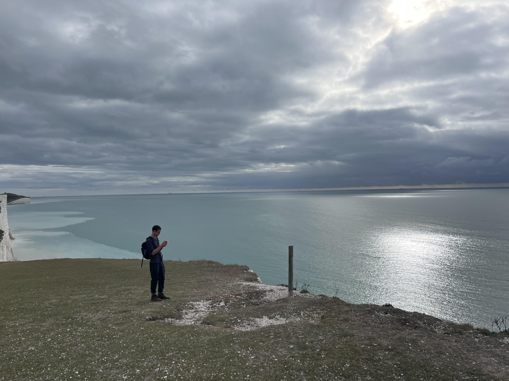
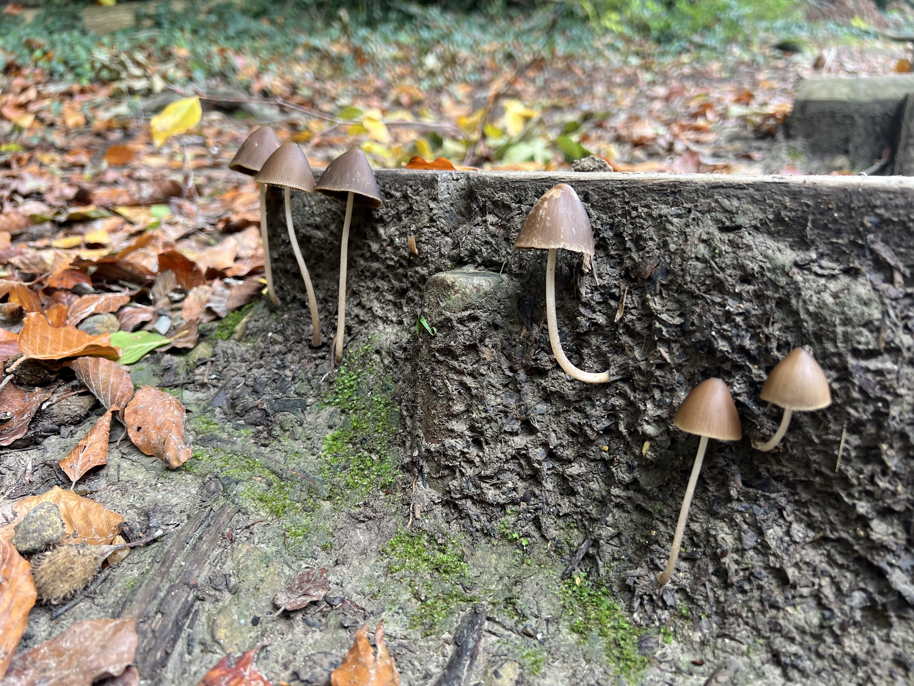
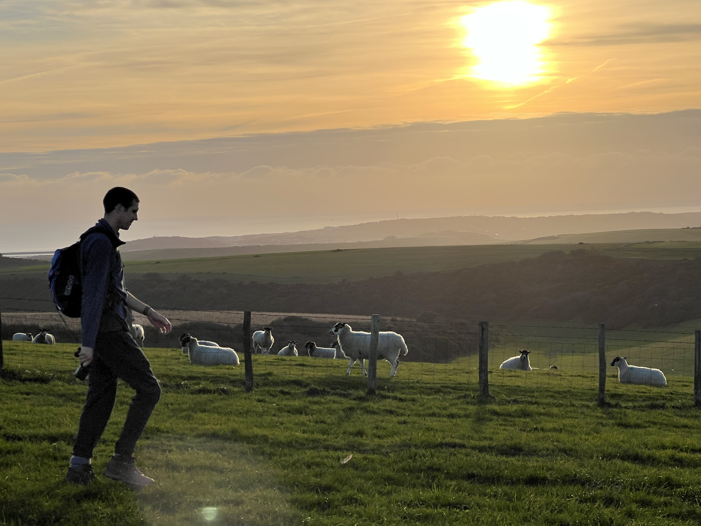
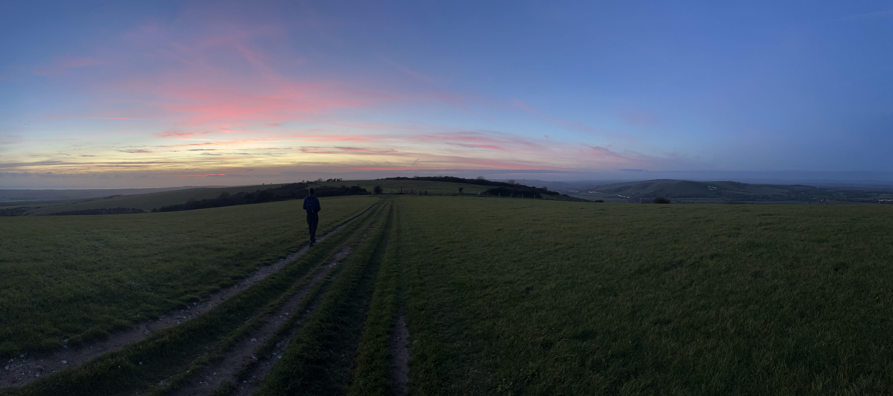
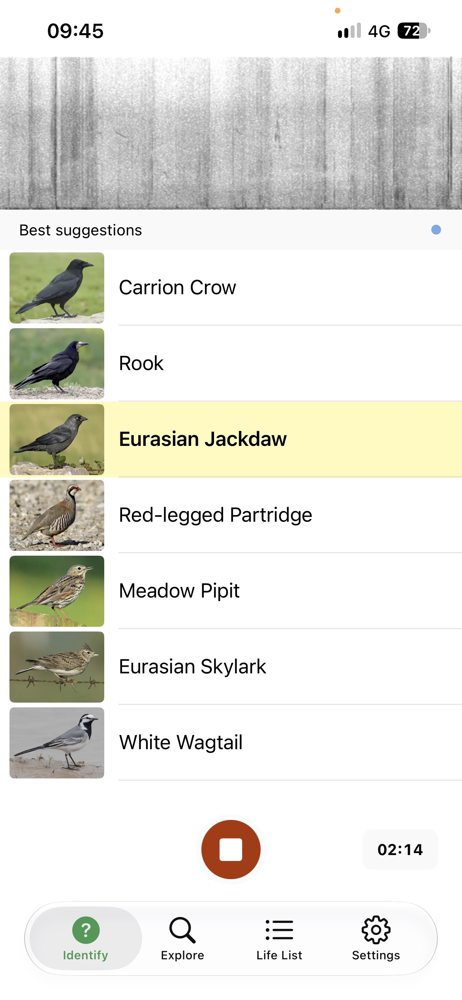
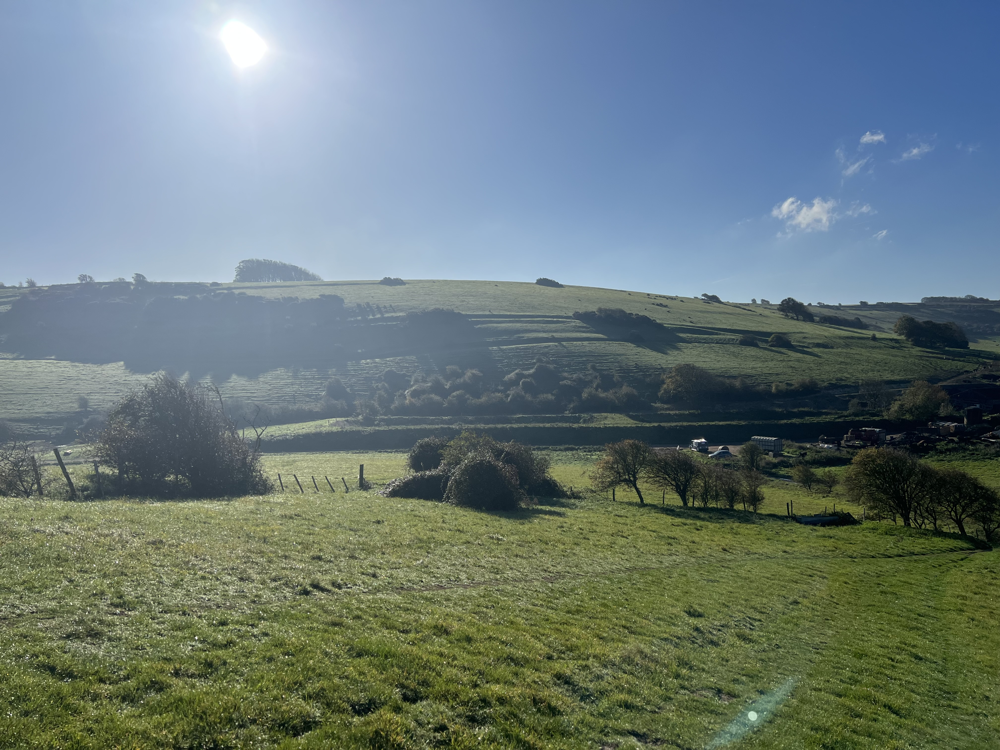

* November!
* The kids spent the week away with their grandparents and their 3 year old Mandarin speaking cousin. They returned with key phrases in Mandarin that any 6 year-old should know - dinosaur, elephant, bottom, Granny [father's mother], Grandad [father's father].
* On Wednesday I went out for cocktails with Rowan in Soho. It was very good to catch up, but the venue I picked was too loud... or... am I old?
* Lachie and I took two days off and walked the 50km from Eastbourne to Brighton over the South Downs way. We stayed in a youth hostel - the "youth" part is presumably aspirational - at about 30km in. Every time I walk up something big and then look at something far away I think "everyone should really be forced to walk up something big and look at something far away". Outside is _what?_ FREE!.
* I will say that walking that far over two days wasn't hard but it was extremely painful. My feet were wrecked by the end of it.
* Lachie and I had time to talk about many things over the two days and one of them is "would you rather learn to fly a plane or sail a boat". Lachie is a boat guy of course. We all know plane guys. The reason this came up was because on the Downs there are loads of people flying little two seater planes, presumably because the view is nice and because you can keep your bearings easily along the coast. We even saw one man* doing loop the loops, nose dives, barrel rolls etc. *Obviously I can't know this person was a man. But I think we can all agree that it was almost definitely a man.
* Once back at home, E and I cut up all her old dresses that were too worn out for the charity shop (all of them being at least second hand by the time they reached us) and made them into patchwork bags to give to various people. She is pretty handy on the sewing machine and all I had to do was iron.
* Wee man's fave top is a red adidas zip up. This is ideal. He looks like Robbie Williams at glasto (very cool), and I can snap a photo and do a reverse image search it on vinted and buy him the next size up for £4.

