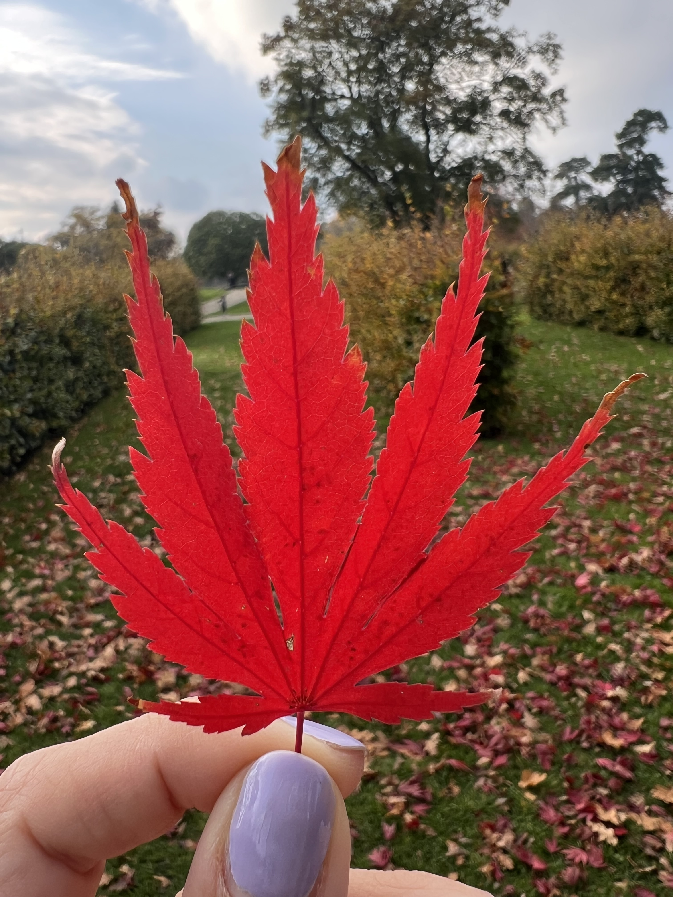
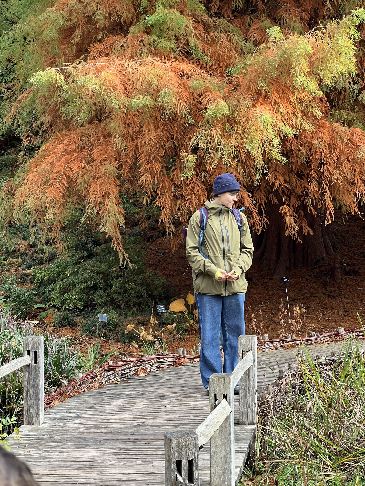
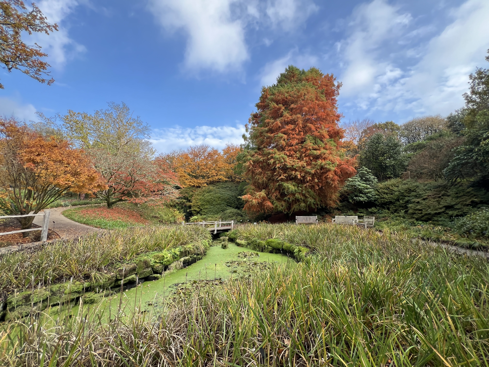

* In the middle of the night last week, we were awoken by a strange noise in the bathroom. My Oral B electric toothbrush had turned itself on. Lachie leapt out of bed, unsure what the noise was but determined to find out. This is third time one of our toothbrushes has become haunted. Last time this happened to me was [2022](https://alicebartlett.co.uk/blog/weaknotes-285). E says it's broken, but if it was broken surely it _wouldn't turn on_. The problem with this toothbrush is it works a little _too well_. So it can only be a ghost honestly. And the proximity to halloween? come on.
* When this happened before, Lachie took apart the haunted toothbrush and scared the ghost away with his soldering iron. However the toothbrush became haunted again a few months later. I've said he can have a go at exorcising my toothbrush if he wants but I'm not hanging around for that to get to the top of his to-do list.
* I got a toothbrush from boots. It's the fancier model but was also discounted to be cheaper... I don't know how the economy works.
* Wee man has been talking for months about the cookie cutter fish, so named because it's mouth is shaped like a cookie cutter. Finally I looked up this cute sounding fish. Wow. what a horror-show. This fish's bottom teeth are the shape of a cookie cutter, and it uses its floppy top lip to suck onto other sharks and then it rotates round taking a perfect hockey puck of flesh to snack on.
* Question: Why is there a fine yellow-green residue over everything in the garden? Is it fireworks related or is it tree pollen.
* I made [tom stuart's ruby tandoh's too hot soup](https://tomstu.art/weeknotes-2-the-good-half). Did you know you can freeze ginger, and then it's not stringy when to grate. I learnt that on TikTok. One time Sainsbury's online was selling ginger for minus 1p. A shame I didn't know you could freeze ginger back then, I'd be a ginger millionaire.
* A glimmer of hope from the US this week.
* Went to Wakehurst yesterday. Great photons. 

