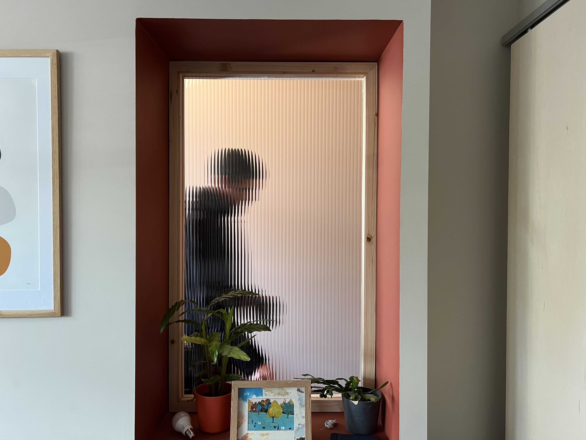

* We have a damp patch. A plumber came out and said it was the silicone so maybe it's fixed.
* OH: "I was like 'how're you?' and she just went on and on and on. Like, I already have a girlfriend, spare me your life's story". These two lads went on in this vein for a while saying things I don't even want to repeat.
* Amazing to be so close to the two worst men in the world.
* Last week's pollen or gunpowder question was answered by a squirrel. I was looking out the window at my neighbour's boy-cedar. It's got it's little pointy boy bits out at the moment. You know, the bits that aren't the tree-eggs that our lady tree gets. Anyway this squiz leaps onto a branch and a big poof of yellow pollen wompfs right off of the tree.
* I've been watching Black Doves with Lachie. Not really enjoying it because it is too silly. I was really really pleased to see that the FT's building is the fictional head quarters for the Black Doves though. Every time they enter or exit the building - that's the Brack Shack! The inside shots are _not_ Bracken House though the meeting room names are the same, as is the typography?!
* We went to london this week to see our friends The Baddlands. They made us some really decent Pho which we will be making at home. We also saw a lot of the gang including three very good 1ish year olds.
* One of Chaz's favourite games to play with me is wrestling. Of course I mostly let him win. Today after beating me 3-2 he told me "you know why I beat you mum? because after i kicked [e] in the neck I went and used your weights to do some muscles". And then he did a _really_ amusing impression of bicep curls. Don't ask about the neck kicking thing.

